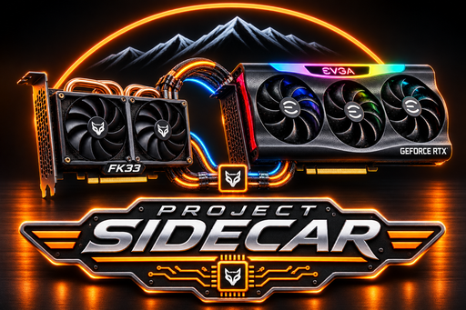

  

# Project Sidecar

GPU + FPGA cooperative compute research for PearlHash/PRL using NVIDIA RTX GPUs and SQRL FK33 accelerators.

## Current status — November 2026

### Latest PRL FP8 (V4) milestone — November 25, 2026 (afternoon)

**Major local integration milestone:** An actual RTX 3080 executed the B200-profile **v1.3** GPU candidate search and its plain and wrapped proofs passed the unchanged verifier; the resulting **61,769-byte block passed full validation on a reconstructed, source-matched local RegressionNet test chain** with an intentionally achievable target. GPU-A reports **121 candidates at 184.64 attempts/s**, **18/18 unit tests**, and **5/5 adapter negative/control checks**. The preexisting V3 miner was restored and an ordinary share was observed. This is **not public Testnet2 acceptance**.

| Workstream | Most recent evidence | Remaining gate |
| --- | --- | --- |
| **GPU-A — local full-block integration** | RTX 3080 B200 candidate → verified plain/wrapped proof → unchanged **local** full-block validation: **PASS** | Public Testnet2 validator eligibility, authentic target-valid candidate and public acceptance |
| **GPU-B — worker recovery** | Exact pinned searcher/persistent worker recovered, hash-verified; source-matched local RegressionNet full-block result; earlier B200 search **182.95 GPU/s vs 132.61 CPU/s** in a *different* matched benchmark | Sustainable full mining throughput and public acceptance; clean rebuild binary differs from pinned binary |
| **MIDDLE — independent QA** | Pinned-source audit identified source/test-file drift; full-block independent requalification **blocked** until trusted re-freeze | Re-run exactly sourced independent checks, no unqualified policy patch promotion |
| **LEFT — distribution** | Offline FP8 miner **v1.3.0**, **43 tests passed**, 4,756 source files verified | No runtime GPU mining qualification of other RTX models; licensing and service deployment pending |
| **RIGHT — source/provenance** | Recovered CPU-mode local worker passed unchanged verifier and negative controls; detected stale handoff checksum manifest | Reseal immutable handoff before coordinated release; FK33 XDMA remains physically unqualified |
| **QUANTUS-FK33 — new separate lane** | Independent Poseidon2 / QPoW oracle/test work started, [tracked in issue #4](https://github.com/Zombiekilla25/project-sidecar/issues/4) | Official-reference correctness, FPGA implementation timing and later approved one-card silicon validation |

**Network status:** No GPU-produced PRL FP8 block or share has been accepted on **public Testnet2**. A fresh public job passed read-only checks, but no public-target search or submission occurred. GPU-A's stated model estimated roughly **31.8 years per qualifying result** at this search rate and specific target; it is an estimate, not production profitability. No FK33 FP8 physical acceleration or standalone Quantus mining has been demonstrated.

**[Detailed November 25 FP8 engineering report](docs/milestones/2026-11-25-prl-fp8-status.md)** · **[Quantus FK33 issue #4](https://github.com/Zombiekilla25/project-sidecar/issues/4)**

### Previous FP8 / PRL V4 milestone — November 24, 2026

**Current priorities:** (1) keep NVIDIA RTX 30-series GPUs viable for PRL's proposed **FP8 (V4)** update; (2) use FK33 FPGAs as GPU co-processors **only when measured end-to-end benefits justify it**; (3) explore independent FK33 mining afterward. Existing V3 production mining has not been replaced by this experimental work.

| Workstream | Demonstrated result | Qualification boundary |
| --- | --- | --- |
| **RTX 3080 FP8 arithmetic** | Real SM86 CUDA execution reproduced pinned H100- and B200-profile arithmetic; CUDA-produced proof/certificate outputs passed unchanged **local** official verification | Does **not** demonstrate public-network eligibility or production mining |
| **RTX 3080 full-block validation** | An SM86-generated H100-profile candidate passed unchanged **local** V4 full-block validation on an isolated easy-target chain, including negative controls | Not a public Testnet2 block or share |
| **V4 search performance** | In one matched 12-thread campaign, optimized CPU search reached **159.77 attempts/s**, versus original CPU **110.61 attempts/s**; optimized GPU hybrid reached **137.19 attempts/s** | These are bounded local workload measurements, **not** accepted network work rates. The hybrid did not beat the optimized CPU |
| **Fleet support** | Offline source-locked compatibility/rollback packaging and RTX 3080 testing completed | The other RTX 30-series device classes are not yet independently qualified for FP8 V4 |
| **FK33 co-processing** | Offline reference-matched RTL/transport prototypes were preserved | No physical FK33 V4 speedup, qualified high-bandwidth link, board timing signoff, or production bitstream |

The current CUDA approach relies on **software reproduction** of supported H100/B200 FP8 arithmetic, not native RTX 30-series FP8 Tensor Cores. Whether the actual V4 network permits using a supported-profile certificate computed on Ampere remains **unconfirmed under public Testnet2 consensus**. A local Testnet2 node provided genuine work templates, but no fresh RTX 3080-produced target-winning candidate was submitted or accepted. A proposed V4 activation/eligibility rule should not be confused with a verified mainnet switch.

**Next evidence gates:** (1) qualify the exact deployed V4 consensus rules and a fresh-job end-to-end candidate; (2) optimize *complete* GPU search throughput against the strongest matched CPU baseline while preserving exact arithmetic; (3) demonstrate public Testnet2 acceptance only with real qualifying work; (4) measure an actual FK33 link before expanding FPGA offload. No experimental outcome above should be interpreted as verified PRL revenue.

Project Sidecar is testing whether an FK33 pod can accelerate selected PearlHash stages alongside a GPU. The project evaluates end-to-end work, including transfer, synchronization, scheduling, FPGA processing, and host verification.

### Engineering baseline — November 22, 2026 (historical snapshot)

**Goal:** develop a real, measurable Pearl (PRL) mining accelerator using NVIDIA RTX hardware and eight SQRL FK33 FPGA cards. Work is split between today's V3 mainnet candidate/proof pipeline and a separate V4 FP8/H100-arithmetic path on **PRL Testnet2**. Neither workstream is claimed to be a production-qualified FPGA miner.

**PRL Testnet2 (V4 FP8):** a locally operated node/gateway path has acquired authentic V4 mining jobs, and source-locked CPU/GPU experiments have produced proofs accepted by the unchanged **local** verifier. RTX 3080 execution and proof-consumer lineage have been tested on bounded workloads; no reproducible end-to-end GPU speedup has been established. These tests do **not** demonstrate an FK33 generating a live target-valid Testnet2 proof, a node-accepted block, or a network-accepted share.

**FK33 V4 FPGA implementation:** a four-lane K=1024 FP8 board-top candidate has been synthesized, placed, and routed using licensed Vivado 2026.1 on the VU33P target. A square-root-pipeline routed candidate reported setup WNS **-1.808 ns** (23 failing endpoints); a subsequent CDC-cleanup routed candidate completed with setup WNS **-2.072 ns**, TNS **-46.132 ns**, and 23 setup endpoints still failing, with hold WHS **+0.010 ns**. The later implementation still reports six **TIMING-35** methodology critical warnings and uses a **conditional 30 MHz JTAG/TAP timing scenario**, not physically established FK0957 board timing. A routed checkpoint exists, but **timing/CDC signoff is incomplete, no bitstream has been generated for this candidate, and no V4 FPGA silicon or Testnet2 mining run has been demonstrated**.

**PRL V3 mainnet path:** archived V64/V64b FPGA and host work, physical FK0957 KAT evidence, and separately developed candidate scheduling and target-hit-filter RTL are being reconciled. The current filter passes bounded offline reference/RTL tests for CPU-supplied digests. The recovered fixed-window endpoint cannot yet generate arbitrary candidate digests or complete proofs; official candidate-specific commitments, noise, arithmetic, digest computation and proof binding remain integration blockers. Passing standalone CPU proof fixtures is not an end-to-end FPGA mining result.

**Next verified milestones:** (1) resolve real VU33P setup timing and TAP clock/CDC constraints; (2) integrate and independently verify a candidate-specific official PRL compute-to-proof chain; (3) qualify the **same** image on one designated nonproduction FK33 with confirmed silicon revision, exact identity and rollback; (4) obtain a fresh Testnet2 V4 job, produce a verified target-valid proof using actual FPGA computation, and retain node-level acceptance and canonical-chain evidence before claiming success. Keep existing production miners untouched until an explicitly authorized maintenance window.

See [the ongoing public-safe engineering log](https://github.com/Zombiekilla25/project-sidecar/issues/3). Numerical results are implementation snapshots under their stated constraints, not measured hashrates or revenue.

### Earlier PHK1/PHK2 milestones (retained for history)

### PHK1 diagnostic path

The PHK1 work now has a candidate-aware diagnostic launcher, a versioned evidence capture flow, split USER3 error reporting, and a bounded RAW_BSCAN transport backend. Target/peer checks fail closed, and the control path has modeled rollback and recovery behavior. The candidate runtime has passed target-host no-hardware fixtures and deployment-binding checks.

The 72-hour offline reliability campaign completed 2,815,825,360 modeled attempts and 72 of 72 deterministic regression checkpoints passed. It found no product defects or safety-invariant violations. One mock-harness defect was corrected during the campaign; its failure record was retained, and subsequent regressions passed. No hardware activity occurred during the campaign.

PHK1 physical protocol qualification is **not complete**. A prior silicon diagnostic observed a tile-0 error whose internal source remains unresolved. The latest fail-closed preflight also found an identify-phase diagnostic evidence/attestation integration mismatch before FPGA programming. The launcher continues to block attempts when identity or evidence prerequisites are incomplete. No correct PearlHash silicon result or acceleration claim is made.

### PHK2 autonomous work generation

Retained production captures were recovered and replayed against a production-backed CPU oracle. Production operand generation and the PHK2 core now have offline RTL qualification, including exact production operands, CPU/RTL differential checks, batch-64 exactness, and abort, reset, backpressure, and stale-generation tests. This establishes functional equivalence within the tested profiles and fixtures; it does not establish physical implementation or mining performance.

### PHK2 synthesis findings

An **initial synthesis baseline** for the first fully combinational work-generation design completed for the VU33P family. It used approximately 327,854 LUTs (74.57%), 1,372 DSPs (47.64%), 2,202 flip-flops, and no BRAM or URAM. This is a resource measurement for an unoptimized architecture, not a routed design. Timing analysis did not complete, and the measurement wrapper was unsuitable for placement and routing. The result motivated a sequential, time-multiplexed keyed-BLAKE3/work-generation architecture.

### PHK2 pre-live physical-qualification hardening

The PHK2 first-silicon control path has advanced from general offline closure into a fail-closed pre-live qualification flow. The current software separates offline qualification from physical evidence, requires explicit owner-approved physical limits and methods, and keeps unqualified physical cases blocked.

A single-target descriptor identity path was added for the first physical canary. It is designed to refuse ambiguous or peer-device access, exposes no programming/reset/JTAG capability in the descriptor-only backend, and keeps evidence signing local to the trusted host. Remote acquisition was split from local validation/signing so private signing material is never required on the hardware host. SSH host authentication, source/hash pinning, replay protection, symlink/hardlink refusal, and atomic evidence output have been independently exercised in offline tests.

The first live descriptor attempt correctly stopped before device access when the remote environment did not contain the expected checkout. A no-checkout ephemeral collector/bundle mode has since been implemented so the reviewed acquisition payload can be transmitted and executed without trusting a remote repository. Independent adversarial audit of that new mode is in progress. No PHK2 JTAG, BSCAN qualification, FPGA programming, reset, or silicon-performance claim follows from this work.

### Next steps

1. Complete the independent audit of the PHK2 no-checkout ephemeral descriptor-acquisition path, then perform the separately authorized single-card descriptor-only identity observation.
2. Finish owner approval of PHK2 physical measurement limits/methods and the authoritative read-only BSCAN observation contract before any deeper physical qualification.
3. Continue the resource-efficient sequential PHK2 work-generator path and physical-design work behind a realistic interface before making any silicon-performance or scaling claim.
4. Resolve the remaining PHK1 identify-phase evidence/attestation preflight mismatch before its separately authorized one-card diagnostic canary.

## Qualification boundaries

The evidence types above are distinct: software and RTL results are offline-qualified; the PHK2 resource figures are synthesis-only; neither establishes silicon correctness, timing, or end-to-end speedup. PHK1 physical qualification remains open. PHK2 routing and silicon qualification have not been demonstrated.

The project license has not yet been selected. Do not assume permission to redistribute third-party RTL, vendor IP, bitstreams, or external source code.

## Project logs

GitHub contains public-safe milestone summaries, not raw machine/runtime evidence. See [logging and evidence policy](docs/logging.md) and the [November 2026 PHK1/PHK2 milestone](docs/milestones/2026-11-phk1-phk2-progress.md).
