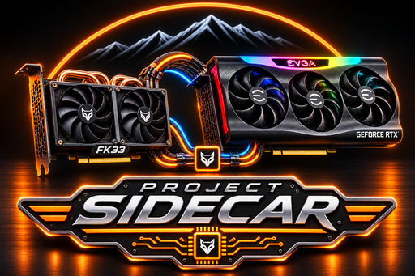

  

# Project Sidecar

## Sidecar miner 0.3.0-rc1

This software release candidate combines the PRL miner frontend and CPU verifier, supervised one-share canary guard, backend qualification artifacts, offline FK33 fleet controller, and first-silicon benchmark/scaling analysis. The offline suite passes 244/244 tests; the mock fleet completed 10,000 assignments. Real CUDA and PHK1 physical backends remain unqualified, and live pool access remains disabled. The patched PHK1 candidate passed offline simulation, synthesis, implementation, timing, and DRC checks; VU33P bitstream generation is blocked because the available Vivado license does not permit `write_bitstream` for that target.

See the [release-candidate source](releases/sidecar-miner-0.3.0-rc1/README.md) and [public software milestone](docs/run-logs/2026-11-03-sidecar-miner-0.3.0-rc1.md).

GPU + FPGA cooperative compute research for PearlHash/PRL using NVIDIA RTX GPUs and SQRL FK33 accelerators.

## Current status

Proven:
- GPU PearlHash/PRL mining path is operational.
- CUDA Redux optimization has produced real pool-accepted PRL shares.
- FK33 V5.3 PearlHash compute and fast-reload operation are qualified.
- V7 same-generation job renewal is qualified on real FK0957 hardware and across the eight-card pod.
- Authenticated rollback/recovery is proven after controlled coordinator loss.
- A Gen3 x4 PCIe/XDMA FK33 image has completed offline routing, timing, DRC, and release packaging.
- The current H0 qualification stack passes 67/67 regression tests and 51/51 single-owner security tests.
- A read-only physical FK33 USB stability soak completed 360/360 samples with zero disappearances, zero state changes, and zero serious kernel USB errors.
- The current serial qualification set has 12/12 case-runs satisfying their declared oracle with 6/6 deterministic repeat pairs.
- Qualification reporting now separates raw PASS/FAIL from oracle satisfaction so intentional fail-closed safety tests remain visible without being misclassified.
- The V4.1 integrated host candidate is fixture-qualified, including 5/5 known bypass closures in the fixture model, bounded D01 target policy, three-principal authority binding, two-inventory regeneration, rollback/recovery, and integrated failure injection.
- The protected host boundary has been installed successfully with 6,278 candidate files verified and direct unprivileged candidate/native execution denied.
- L02 S05 authenticated persistent-quarantine recovery is **offline-qualified**: **1,253/1,253 retained tests PASS**, including **44/44 dedicated recovery tests**, with 0 failures and 0 errors.
- S05 target userspace compatibility is **qualified**: **1,253/1,253 PASS** locally and on target, with the exact descriptor inventory retained.
- The initial Project Sidecar production deployment is **complete**. The guarded production transaction committed with **60/60 planned mutations, 0 unexpected mutations**, **40/40 installed-file checks PASS**, successful supervisor/worker privilege separation and handoff, and no rollback.
- The installed production runtime completed a **15-minute read-only soak PASS** with stable service health, unchanged restart counters, preserved protected workloads, preserved shared-ancestor metadata, and no FPGA/JTAG or mining changes.
- The FK0957 one-card hardware canary remains separately gated and has not been authorized or executed.

Not yet proven:
- Full 322-case × 2-repeat qualification.
- 114/114 H0-site coverage on both full-campaign repeats.
- 322/322 deterministic repeat pairs on the full campaign.
- PCIe/XDMA operation on FK33 silicon.
- Measured host-to-FPGA DMA latency/bandwidth.
- A real GPU-produced PearlHash intermediate offloaded to FK33.
- Positive end-to-end GPU+FPGA speedup.
- A pool-accepted PRL share generated by the FK33 V5.3 mining path.

See [qualification progress](docs/qualification-progress.md) for the current safety/validation milestone and remaining gates.

## Goal

Project Sidecar tests whether an FK33 pod can accelerate selected PearlHash stages alongside a GPU instead of operating only as independent miners. A sidecar is a win only if end-to-end throughput improves after transfer, synchronization, scheduling, FPGA processing, and return-path overhead are included.

## Immediate next milestone

Keep the newly installed production Sidecar on a stable, read-only observability path while returning engineering effort to the project’s core acceleration goal: qualify the next safe GPU↔FK33 data-path step, measure transport/runtime overhead, and determine whether real end-to-end throughput improves.

The production deployment is now a known-good baseline and should not be redesigned as part of ordinary acceleration experiments. Hardware execution remains separately gated and requires explicit authorization.

See [initial production deployment milestone](docs/production-deployment-milestone.md) for the public-safe deployment checkpoint.

## Project logs

GitHub is used for **public-safe milestone summaries**, not raw machine/runtime evidence. See [logging and evidence policy](docs/logging.md).

## Safety

Bring-up is fail-closed with authenticated releases, fixed hardware identity, independent recovery supervisors, bounded job renewal, authenticated rollback, and a retained BSCAN/JTAG recovery path. Public submission stays disabled during transport and sidecar qualification.

## License

A project license has not yet been selected. Do not assume permission to redistribute third-party RTL, vendor IP, bitstreams, or external source code.
