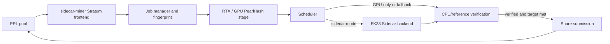

# Project Sidecar mining frontend

This package is the upper half of a future PearlHash mining application. It runs offline by default; `sidecar-miner` prints an offline-scaffold notice and never opens a pool connection. Tests use a deterministic loopback Stratum fixture.

## Components

- **Pool frontend (`stratum.py`)** speaks Kryptex PRL JSON-lines Stratum: `mining.configure`, `mining.subscribe`, positional `mining.authorize`, `mining.notify`, `mining.set_difficulty`, object `mining.submit`, and request-ID matched responses. The observed notify schema is header (76 bytes), job ID, explicit share target, height, and certificate version. Difficulty is retained as telemetry/context; the explicit target is authoritative. Clean-job is optional because the observed PRL schema does not document it.
- **Job manager/model (`models.py`)** validates the observed PRL fields, attaches a monotonic sequence and receive time, and produces a canonical serialization and SHA-256 fingerprint. GPU and FK stages can compare this fingerprint to ensure they worked on the same job.
- **GPU backend (`backends.py`)** defines `prepare_job` and `compute_batch`; the included deterministic mock produces no PearlHash proofs. A production CUDA adapter can implement this contract later.
- **FK33 backend (`backends.py`)** defines `prepare` and `execute`. It intentionally contains no libftdi, JTAG, or PHK1 integration; those must remain behind the existing Sidecar backend.
- **Scheduler (`scheduler.py`)** supports `gpu-only` and `sidecar`. FK errors switch to GPU-only and increment a fallback counter. Work partitioning is intentionally not selected yet.
- **Share verification (`verification.py`)** checks job identity/fingerprint, calls an injected CPU/reference verifier, then compares the candidate result hash against the explicit job target. Only a successful `Verification.share` is acceptable at the submit boundary.
- **Submission** is deliberately a protocol boundary. A share carries the object submit parameters produced by the eventual PearlHash proof adapter. Local documentation says Kryptex's live proof format is pool-specific and krig uses protobuf; the research repo's `v2-json` format is mock-only, so this scaffold does not invent a live encoding.
- **Reconnect policy (`reconnect.py`)** provides bounded exponential backoff with jitter; reconnect orchestration belongs to the runner.
- **Telemetry (`telemetry.py`)** models connection/job state, share outcomes, GPU/FK job and batch counts, stage/transfer/end-to-end timing, fallback count, and backend health.
- **Configuration (`config.py`)** accepts a local JSON file and `SIDECAR_POOL`, `SIDECAR_WALLET`, `SIDECAR_WORKER`, `SIDECAR_MODE` and reconnect settings. Wallets are not in source; local config and `.env` are ignored.

## Intended flow

The intended product flow is **PRL pool → sidecar-miner → RTX → FK33 → verification → pool**. GPU-only mode remains available if FK acceleration is unavailable. This branch has no live-pool or hardware path enabled.

## Protocol evidence and limits

The implementation follows the local `project-sidecar-research/pearl-reference/PROTOCOL.md` and `pearlhash/stratum.py` observations. Those notes describe configure/subscribe/authorize, 76-byte headers, explicit targets, and object submit params. They explicitly identify the live proof encoding as pool-specific. The local open Pearl miner's Luckypool protocol is a distinct/reverse-engineered implementation and was not copied as the Kryptex contract. This scaffold must be paired with an authoritative production proof encoder and PearlHash CPU verifier before live submission is enabled.
