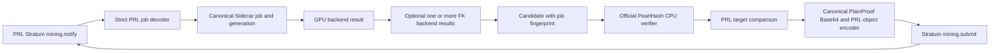

# Project Sidecar mining frontend

The frontend now has an offline PRL-aware candidate path. It has not been live-qualified and its GPU/FK implementations remain interfaces/mocks. `sidecar-miner` CLI is deliberately non-networking.

## Concrete flow



The intended mining flow is **PRL Stratum job → canonical Sidecar job → GPU/FK backend → candidate → CPU PearlHash verification → target gate → encoded share → pool**. Current tests exercise the same path against a loopback fixture only.

## Implemented components

- **PRL decoder (`prl_job.py`, `models.py`)** accepts only a JSON-RPC `mining.notify` notification with `job_id`, 76-byte `header`, 32-byte hex `target`, uint64 `height`, and supported `cert_version` 1–3. Optional `clean` is type-checked; the observed PRL schema does not establish a clean field. Every valid job notification advances `generation`, which invalidates prior work even when its content repeats. The SHA-256 job fingerprint uses canonical sorted JSON over the PRL identity fields and excludes arrival time, sequence, difficulty notification, and clean delivery metadata.
- **Target model (`target.py`)** follows the local official Pearl miner and Rust reference: the notify target is the raw share-target basis, compact-encoded without rounding it upward for verifier input, then multiplied by `tile_rows × tile_cols × k` for the PearlHash jackpot bound with U256 saturation. Hashes are compared as little-endian U256 values with equality accepted. The official Rust verifier also applies certificate/rank checks.
- **CPU verifier (`pearlhash.py`)** uses `py-pearl-mining`'s Rust `verify_plain_proof_for_cert_version` (or the version-specific official functions). It parses/reuses native `PlainProof` objects, derives the proof config and cert-version-specific `sigma`/`b_seed` from official proof roots, and enforces the official proof and target rules. The binding returns `(valid, message)`; it does not expose its recomputed jackpot digest. `Verification` therefore reports the backend-reported digest separately and does not present it as a CPU-computed digest. The native verifier is the independent submission gate.
- **PRL share encoder (`share_encoder.py`)** uses the official native `PlainProof.to_base64()` representation (standard Base64 over native bincode proof bytes), decodes those bytes, gzip-compresses them, then Base64-encodes the gzip member. The locally captured KRig accepted request and encoder source establish exact `mining.submit` params: `job_id` and `plain_proof`. The accepted local proof fixture round-trips through the native binding and decompresses byte-for-byte. The Python gzip member is deterministic but not claimed to be byte-identical to .NET's compressor output; both represent the same gzip payload. No live submission is performed.
- **Submission safety (`verification.py`, `stratum.py`)** requires a locally sealed successful verification, candidate/job identity and generation match, backend correctness, valid seed and nonce fields, CPU proof verification, and target acceptance. A newer job makes an already verified result stale at submit time. Unknown/malformed jobs and candidate proof encodings fail closed.
- **Timing and telemetry (`telemetry.py`, `backends.py`)** record job parse, GPU, FK, verification, submit encoding, and submission durations. Values are measured at runtime; no performance rates are estimated.

## Mocked and not yet live-qualified

- **GPU backend** is an interface plus `MockGpuBackend`; no CUDA kernel or mining workload is run.
- **FK33 backend** is a high-level interface with mock/unavailable behavior. It contains no libftdi, JTAG, or PHK1 dependency. Scheduler shape accepts zero, one, or multiple FK backends; production scheduling is not enabled.
- **Stratum fixture** binds only `127.0.0.1`, supplies deterministic job/difficulty/clean-job cases, validates outbound object params, returns accepted/rejected responses, and exercises disconnect/reconnect. No DNS or external socket calls are part of tests.
- **Share wrapper qualification** is limited to local protocol evidence and fixture behavior. The locally captured KRig JSON-RPC submission and accepted proof establish the outer `job_id`/`plain_proof` envelope and proof compression. Full live session interoperability has not been re-qualified by this frontend; live submission remains disabled.

## Reproducible offline checks

Install the dependencies in `requirements.txt`, including the official `py-pearl-mining` binding, then run:

```sh
python3 -m unittest discover -v
```

The test suite covers strict PRL job parsing, canonical identity, target boundaries and compact conversion, CPU vectors and the official native verifier, canonical proof serialization, verification gates, stale generations, and the complete loopback Stratum exchange.
